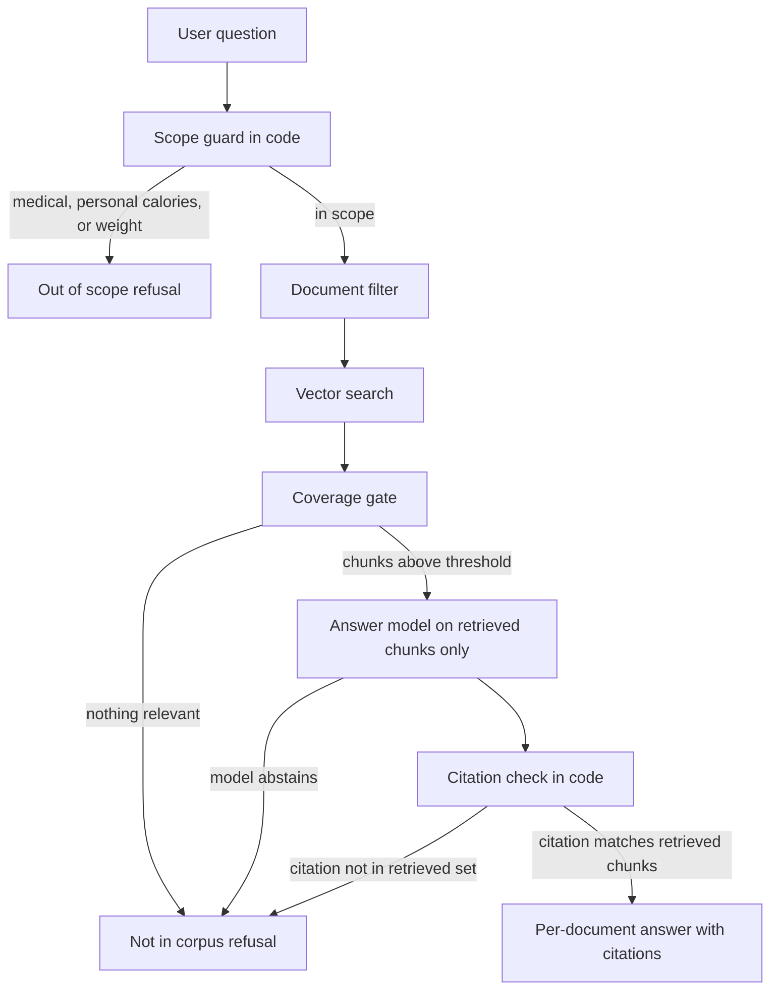

# Dietary Guidance RAG Chatbot — Architecture

This is the build design for the prototype in [problemStatement.md](problemStatement.md). The assistant answers food, nutrition, and food-safety questions only from seven official guidance documents. Every claim cites the document it came from. Questions the guidance does not cover are refused by name. Medical advice, personal calorie targets, and weight targets are refused in code before any retrieval or model call.

The prose is already extracted. Indexing and answering use [blocks.jsonl](https://raw.githubusercontent.com/saksham20189575/health-data/main/blocks.jsonl). That file saves tokens. It does not replace the citation catalog, and the model never sees a whole document.

## 1. Design choices

| Choice | Decision | Why |
| --- | --- | --- |
| Pipeline | Plain Python modules | The scope guard and the citation check have to be visible code, not a hidden chain step. |
| Text source | Downloaded snapshot of `blocks.jsonl` | Same seven documents as the problem statement. No PDF parsing. |
| Chunking | Group prose by `heading_path`. Split tables into one chunk per row, with the header copied onto every row. | Fixed-size windows cut numbered rules and storage-time rows apart. The Cold Food Storage Chart is one table; row chunks make "how long for eggs?" retrieve eggs. |
| Embeddings | Local model (`all-MiniLM-L6-v2` or the same size class) | About a thousand chunks. Indexing should not spend answer-model tokens. |
| Vector store | Persistent store with metadata filters (Chroma, or an equivalent local index) | Required modes are search-all and search-one-`document_id`. |
| Answer model | One chat model, called only after retrieval, with a structured JSON response | The prompt contains retrieved chunks only. |
| Conversation | Stateless. Each question is independent. | A previous answer must not become a source for the next one. |
| Page | One local page over the same entry point. No build step. | The browser displays the validated result. It does not retrieve or call the model. |
| Scope guard | Deterministic rules in this project, run first | Prompt wording is not the enforcement. There is no earlier milestone to copy. |

## 2. System shape



Five stages handle a question. Only one of them calls the answer model.

1. **Scope guard.** Code classifies the question. Out-of-scope questions stop here.
2. **Route.** Code decides whether search is across all seven documents or limited to one `document_id`.
3. **Retrieve.** Embed the question and return the top chunks, optionally filtered.
4. **Coverage gate.** If nothing is close enough, code returns "not in the corpus" and names the search scope. The model is not called.
5. **Answer and check.** The model writes one section per retrieved document. Code checks that every citation belongs to a chunk that was actually retrieved.

## 3. Repository layout

```text
data/
  catalog.json          # publisher, year, source URL, retrieval date, document name
  blocks.jsonl          # downloaded snapshot
  index/                # persistent vector index
src/
  ingest.py             # download blocks, join catalog
  chunk.py              # heading groups and table rows
  index_corpus.py       # embed and write the index
  scope.py              # out-of-scope guard
  retrieve.py           # all-document and single-document search
  answer.py             # prompt, model call, abstain
  validate.py           # citation check against retrieved chunks
  app.py                # CLI, and the localhost server for the page
web/
  index.html            # one question, latest result only
```

`catalog.json` is source-controlled. `blocks.jsonl` and `index/` are built artifacts. The retrieval date stored in the catalog is the date that snapshot is downloaded.

## 4. Corpus

### 4.1 Catalog

One record per document. `document_id` joins blocks to citations.

| Field | Source |
| --- | --- |
| `document_id` | Block file |
| `document_name` | Problem statement table |
| `publisher` | Problem statement table |
| `year` | Problem statement table |
| `source_url` | Official URL in the problem statement. Never the `blocks.jsonl` URL. |
| `retrieval_date` | Date `blocks.jsonl` is downloaded |
| `kind` | `nutrition` for `who-healthy-diet`, `fao-who-healthy-diets`, `eatwell-guide`. `food_safety` for the other four. |

The seven ids and their official pages are the table in §3.1 of the problem statement. Ingest rejects a block whose `document_id` is not in this catalog, and it rejects a catalog id that never appears in the file.

### 4.2 Block record

Each JSONL line is one structural block:

| Field | Use |
| --- | --- |
| `document_id` | Join the catalog. Filter retrieval. |
| `ordinal` | Reading order inside the document. |
| `type` | `heading`, `paragraph`, `list_item`, or `table`. |
| `text` | Prose or markdown table. |
| `heading_path` | Section stack. This becomes the chunk's section heading. |
| `page`, `level` | Present on some blocks. Kept for debugging. Not required to answer. |
| `header`, `rows` | Present on tables. Used to split rows without losing column names. |

Page-furniture lines that only repeat the document title are dropped during ingest. They are not guidance.

## 5. Chunking

Fixed-size splitting is not used. A chunk is either a group of prose blocks under one section, or one table row.

### 5.1 Prose

Walk each document in `ordinal` order.

- A `heading` updates the current section. It is not its own chunk.
- Consecutive `paragraph` and `list_item` blocks with the same `heading_path` accumulate into one chunk.
- Flush the chunk when the heading changes, or when the accumulated text passes about 500 tokens.
- A flushed chunk's section heading is `heading_path` joined with ` > `.

Small list items stay with the sentence that introduces them. A 500-token cap stops a long section, such as the kitchen companion, from becoming one chunk that crowds out every other document.

### 5.2 Tables

If a block has `type: table` and a `rows` array:

- Emit **one chunk per row**.
- The embedded text repeats the column headers on that row, then the cell values, then the section heading.
- Do not embed the markdown table as a single string when it has more than one data row.

This matters most for `cold-food-storage`, which is one heading, one introduction, and one table of every food. A question about eggs must be able to retrieve the egg row without also being forced to carry ham, fish, and leftovers into the prompt. Copying the header onto each row keeps "Refrigerator" and "Freezer" attached to the times. The cost is more chunks, repeated header text, and no single chunk that shows the whole chart. That trade-off is recorded in the README, as the problem statement requires.

Shorter tables in `eatwell-guide` and `kitchen-companion` use the same row rule so table handling stays one code path.

### 5.3 Chunk metadata

Every chunk stored in the index carries:

| Field | Required by |
| --- | --- |
| `chunk_id` | Stable id, `{document_id}:{first_ordinal}:{row_index}` |
| `document_id` | Filtered retrieval |
| `document_name` | Citation |
| `publisher` | Citation |
| `year` | Citation |
| `source_url` | Citation |
| `retrieval_date` | Provenance |
| `section_heading` | Problem statement chunk contract |
| `ordinals` | Trace a chunk back to the block file |
| `text` | What gets embedded and what the model may quote |

The string that is embedded is the section heading plus the chunk text, so a query can match both the section and the row.

## 6. Index and retrieval

### 6.1 Build

1. Download `blocks.jsonl` and set `retrieval_date`.
2. Join the catalog.
3. Chunk as in §5.
4. Embed each chunk with the local embedding model.
5. Upsert into one collection. Metadata includes `document_id` and the citation fields. The collection is rebuilt from the snapshot rather than edited in place, so the index cannot drift from the file.

### 6.2 Query modes

Both modes are required.

| Mode | When | Filter |
| --- | --- | --- |
| All documents | Default | none |
| One document | The caller passes `document_id`, or the question names one catalog document | `document_id` equals that id |

Name detection is a dictionary from catalog names and common short names ("Eatwell Guide", "WHO healthy diet", "Five Keys") to `document_id`. If the question names two documents, search is unfiltered and the answer layer still separates whatever comes back. If it names one, search is filtered. An explicit `document_id` argument always wins over name detection.

### 6.3 How many chunks

- All-document search: take the nearest 8 chunks, then keep at most 3 per `document_id`. The cap stops `kitchen-companion` (469 blocks) from filling the prompt and hiding a second authority.
- Single-document search: take the nearest 5 chunks from that document only.
- Drop chunks below a similarity floor. If none remain, the coverage gate refuses. The floor is tuned on the questions in §10 and written down next to the chunking trade-off.

The model receives only the surviving chunks, each labeled with `document_id`, document name, section heading, and the citation fields. It does not receive the rest of the collection.

## 7. Scope guard

`scope.py` runs before retrieval and before the answer model. It returns one of three results: `out_of_scope`, `in_scope`, or `in_scope_population_guidance`.

### 7.1 Out of scope

Refuse, with a fixed message, when the question asks for any of these:

- Medical advice: diagnosis, treatment, medication, or what a person should do about a disease or symptom.
- A personal calorie target: how many calories the user should eat, a deficit, or a budget for their body.
- A weight target: what anyone should weigh, a goal weight, or how much weight to lose or gain.

The reply declines and points the person to a qualified professional. It does not cite the corpus and does not call the model. Wording lives in code as a template so the model cannot soften it.

Rules are explicit patterns and phrase lists in this project, plus a small set of tests. They are not a prompt instruction. Examples that must refuse:

- "What should I weigh?"
- "How many calories should I eat to lose weight?"
- "I have diabetes. What diet should I follow?"

### 7.2 Still in scope

Published population guidance is allowed through to retrieval. The nutrition documents state figures such as fat as a share of energy intake, or salt under 5 g a day. Those are claims to cite, not personal targets to calculate.

Examples that must **not** be caught by the guard:

- "What share of energy does WHO say should come from fat?"
- "How long can I keep raw eggs in the fridge?"
- "What does the Eatwell Guide say about oils?"

A question that both asks for a personal target and mentions a guideline still refuses. "Using the WHO fat limit, how many calories should I eat?" is out of scope.

### 7.3 Nutrient numbers

"How much protein is in 100 g of chicken?" is not medical advice and not a weight target. It is also not in this corpus. The guard lets it through. Retrieval will not find a nutrient table, and the coverage gate returns "not in the corpus". The answer model must not fill that gap from its own knowledge.

## 8. Answer layer

### 8.1 Prompt contract

The system instruction is fixed:

- Use only the chunks in the user message.
- Do not add facts from general knowledge, even when the chunks are silent.
- Write a separate section for each `document_id` present in the chunks.
- Do not write a combined paragraph about what "the guidelines" say.
- Under each section, state only what that document's chunks support.
- Copy citation fields from the chunk labels. Do not invent a publisher, year, or URL.
- If the chunks do not contain the answer, set `covered` to false and leave `sections` empty.

The user message is the question, the search scope (all seven names, or the one filtered document), and the retrieved chunks.

### 8.2 Response shape

The model returns JSON:

```json
{
  "covered": true,
  "sections": [
    {
      "document_id": "who-healthy-diet",
      "claims": ["Unsaturated fats in olive and canola oils are preferred to saturated fats."],
      "citation": {
        "document_name": "Healthy diet (Fact sheet)",
        "publisher": "World Health Organization",
        "year": 2018,
        "source_url": "https://www.who.int/docs/default-source/healthy-diet/healthy-diet-fact-sheet-394.pdf"
      }
    }
  ]
}
```

`app.py` returns one validated result, then renders it. The CLI prints each section as prose plus one citation line: document name, publisher, year, link. The local page shows that same result: those sections, or one of the two refusals in §9. Sections stay in catalog order so nutrition and food-safety documents do not get merged by accident. The page sends one question and does not send earlier questions back.

### 8.3 Cross-document questions

No second code path. All-document retrieval can return chunks from more than one `document_id`. The prompt already requires one section per document, and the per-document cap in §6.3 keeps a second document in the prompt.

Cooking oil is the example. Nutrition chunks (`who-healthy-diet`, `fao-who-healthy-diets`, `eatwell-guide`) may speak about dietary fat. Food-safety chunks may speak about storage or chilling if they actually match. Each match is its own section. A document with no retrieved chunk is omitted. It is not summarised from memory.

Smoke point and reusing cooking oil are not in the extracted text. If retrieval finds nothing on that point, the answer is the not-in-corpus refusal, even though other oil guidance exists. Nearby fat guidance is not a substitute.

### 8.4 Citation check

`validate.py` runs on the JSON before it is shown:

- `covered: false` becomes the not-in-corpus refusal. Any sections are discarded.
- Every `document_id` must be one of the retrieved chunks.
- `document_name`, `publisher`, `year`, and `source_url` must equal the catalog row for that id.
- A section with an empty `claims` list is dropped.
- If validation removes every section, the user gets the not-in-corpus refusal, not a repaired answer from the model.

This is what stops a blended or invented citation from reaching the user.

## 9. The two refusals

They are different responses, produced in different places.

| | Not in the corpus | Out of scope |
| --- | --- | --- |
| Where | Coverage gate, or the model sets `covered: false`, or citation check drops every section | `scope.py`, before retrieval |
| Model called | Only if some chunks passed the similarity floor | No |
| What the user hears | The guidance does not cover this question. Then the documents that were searched, by catalog name. | The assistant does not give medical advice, calorie targets, or weight targets, and points the person to a qualified professional. |
| Citations | None | None |

When search was filtered, "what was searched" is that one document. When search was not filtered, it is all seven catalog names. The list is printed from the catalog in code, not written by the model.

## 10. Requests the prototype must pass

These lock the architecture to the problem statement. Each one checks a single behaviour.

| Question | Expected path | Expected result |
| --- | --- | --- |
| How long can raw eggs stay in the refrigerator? | All-document retrieve | One section, `cold-food-storage`, row citation, official FoodSafety.gov link |
| According to the Eatwell Guide, what does it say about oils? | Filtered to `eatwell-guide` | Only that document is cited |
| What do the guidelines say about fats and oils? | All-document retrieve | Separate sections for whichever nutrition documents match. No sentence that merges them into one "guidelines" claim |
| What is the smoke point of olive oil? | Retrieve, then abstain | Not in the corpus. Names the documents searched |
| How much protein is in 100 g of chicken? | Retrieve, then abstain | Not in the corpus. Not a medical refusal |
| What should I weigh? | Scope guard | Out-of-scope refusal. No retrieval |
| How many calories should I eat to lose 5 kg? | Scope guard | Out-of-scope refusal. No retrieval |
| What share of energy intake does WHO recommend from fat? | Scope guard allows it, then retrieve | Cited population figure from a nutrition document. No personal target calculated |

## 11. What this architecture leaves out

- Multi-turn memory, user profiles, and a page that sends earlier questions back.
- Live browsing, PDF parsing, and any corpus other than the seven documents.
- Per-food nutrient lookup. That is Milestone 3.
- A learned scope classifier. The guard is rules and tests in this project. Failures of the rules are fixed by adding cases, not by asking the model to refuse.
- Re-ranking models and query rewriting. The corpus is small enough that metadata filters, a per-document cap, and a similarity floor carry the retrieval contract.

## 12. Build order

1. `catalog.json` with the seven rows and a retrieval date.
2. Download `blocks.jsonl` and join it. Fail if an id does not match.
3. Chunk prose by heading and tables by row. Print chunk counts per document before indexing.
4. Build the vector index. Confirm filtered search for one `document_id` returns no other id.
5. Implement `scope.py` and the refusal templates. The weight and calorie questions in §10 must refuse with retrieval disabled.
6. Implement retrieve, the coverage gate, the answer prompt, and `validate.py`.
7. Run the §10 questions through the CLI and record the chunking trade-off in the README: heading groups, row-level tables, repeated headers, and the extra chunks that buys.
8. Serve `web/index.html` from the same entry point. The page shows the validated result and does not score a question on its own.
