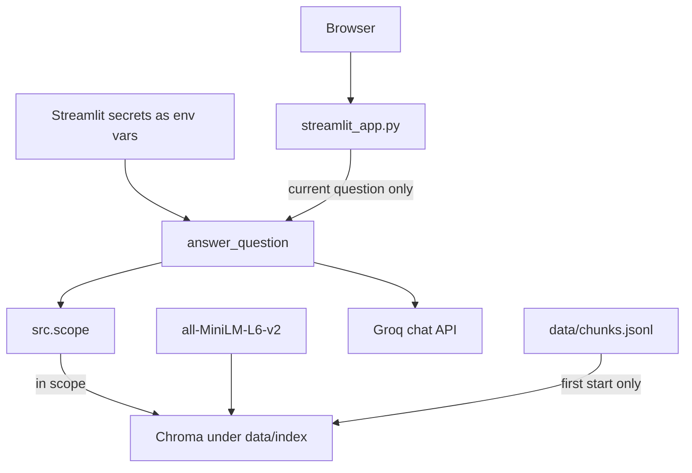

# Dietary Guidance RAG — Deployment Plan

Deploy the prototype as one public Streamlit app. The app is the page. Ingest, chunking, the Chroma index, scope, retrieval, the answer model, and the citation check stay the modules already in `src/`. Streamlit calls `answer_question` in `src/app.py`. It does not grow a second pipeline.

Local use stays as it is: `python -m src.app`, `python -m src.app --serve`, and `web/index.html`. This plan adds a public page on top of that entry point.

## What has to be true in production

| Piece | Where it lives on Streamlit |
| --- | --- |
| Catalog, blocks, chunks | Committed files under `data/`. `data/chunks.jsonl` is about 550 KB and is the index input. |
| Vector index | Built in the container from `data/chunks.jsonl` on first start. `data/index/` is gitignored and is about 4.4 MB locally, so it is not part of the git deploy. |
| Embeddings | Local `all-MiniLM-L6-v2`, loaded once per container. Same model `src/index_corpus.py` already uses. No embedding API key. |
| Answer model | Groq, through the OpenAI-compatible client in `src/answer.py`. |
| Secrets | `CHAT_MODEL`, `CHAT_API_KEY`, `CHAT_BASE_URL` in the Streamlit secret store. `src/answer.py` already reads those from the process environment and skips a missing `.env`. |
| Page behavior | One question per submit. The result is the latest `answer_question` dict. Earlier questions are not sent back. |

`SIMILARITY_FLOOR`, the candidate pool of 32, and the caps of 8, 3, and 5 stay as they are. Scope phrases, chunking, and name detection stay as they are.

## Why one Streamlit app

Community Cloud installs `requirements.txt` from a GitHub repo, runs one Python process, and gives the app a public URL. That matches this repo: a single process already embeds the question, reads Chroma, and calls Groq. Splitting the page and the pipeline would add a service the assignment does not need.

The risk is memory. `sentence-transformers` pulls PyTorch. The default Linux wheel is large. The first boot also downloads `all-MiniLM-L6-v2` (about 90 MB) and embeds 339 chunks. If the Community Cloud container runs out of memory, the same `streamlit_app.py` moves to a container host with more RAM. The pipeline code does not change for that move.

## Target shape



Out-of-scope questions still stop in `src/scope.py` and never embed or call Groq.

## Phase A — Files the deploy adds

Add these. Leave `src/app.py`, `web/index.html`, and the pipeline modules alone except for the dependency pin in `requirements.txt`.

| File | Role |
| --- | --- |
| `streamlit_app.py` | Community Cloud entry point, at the repo root. |
| `runtime.txt` | `python-3.12`. The README allows 3.11 or newer. Pin a version the deploy dialog actually offers. |
| `requirements.txt` | Add `streamlit`, and force the CPU PyTorch wheel so the install does not pull the CUDA build. |

`streamlit_app.py` does four things:

1. Copy `CHAT_MODEL`, `CHAT_API_KEY`, and `CHAT_BASE_URL` from Streamlit secrets into `os.environ` when those names are not already set. On Community Cloud, secrets are also injected as environment variables; the copy keeps the same file working on a host that only exposes `st.secrets`. Existing environment variables win, which is the same rule as `load_env_file`.
2. On first start, build the index when the `guidance` collection is missing. Call `build_index` from `src/index_corpus.py`. Cache that work with `st.cache_resource` so a rerun does not embed the corpus again.
3. Show one question box inside a form. On submit, call `answer_question(question)` and store the dict in `st.session_state`. A later rerun reads that dict. It does not call Groq again.
4. Render the dict with the same rules as Phase 8.

| `stage` | What the page shows |
| --- | --- |
| `answered` | One block per section, in the order received. Claims, then document name, publisher, year, and a link whose href is `source_url`. |
| `not_in_corpus` | `message` only. Names inside the message are text. `chunk_ids` are not shown as sources. |
| `out_of_scope` | `message` only. No link and no document name. |

An empty or whitespace question is rejected in the form and never calls `answer_question`.

A collapsed line may show `stage` and `filter` so a demo can be checked against the CLI. That line is not a citation.

Run it locally before pushing:

```bash
streamlit run streamlit_app.py
```

**Done when:** the app boots from a clean `data/index/` (only `.gitkeep`), prints or displays an indexed count, and one in-scope question returns sections with official links.

## Phase B — Dependencies

`requirements.txt` today is:

```text
sentence-transformers
chromadb
httpx
openai
```

Extend it so Community Cloud installs a CPU build of PyTorch. The `+cpu` version exists on the PyTorch wheel index, not on the default PyPI CUDA wheel. Confirm the exact `torch` version against the `sentence-transformers` release you install, then pin every line from that working venv.

```text
--extra-index-url https://download.pytorch.org/whl/cpu
torch==<cpu version that matches sentence-transformers>
sentence-transformers==<pinned>
chromadb==<pinned>
httpx==<pinned>
openai==<pinned>
streamlit==<pinned>
```

If Chroma raises an error that the system SQLite is older than 3.35, add `pysqlite3-binary` and, at the top of `streamlit_app.py` before any Chroma import, swap `sqlite3` for `pysqlite3`. Do that only after the error appears.

**Done when:** a fresh virtual environment installs from `requirements.txt` and `streamlit run streamlit_app.py` answers one question without downloading a CUDA wheel.

## Phase C — Secrets

The chat key stays out of git. `.env` and `.env.example` are gitignored. Put the three values in the Streamlit app settings as secrets:

```toml
CHAT_MODEL = "openai/gpt-oss-120b"
CHAT_API_KEY = "<groq key>"
CHAT_BASE_URL = "https://api.groq.com/openai/v1"
```

Use the model and base URL already in local `.env`. Paste the key only into the Streamlit secret form. If that key has been copied into a chat, a screenshot, or a commit, create a new Groq key and revoke the old one before the app is public.

The page must not print the key, the request body sent to Groq, or chunk text from the prompt.

**Done when:** the deployed app answers an in-scope question with no `.env` file on the server, and a search of the repo for the key string finds nothing.

## Phase D — Publish on Community Cloud

1. Push the repo to a public GitHub remote. Community Cloud's free tier deploys public repositories. Confirm `.env` is not in the commit (`git status` and a scan of tracked files).
2. Sign in at [share.streamlit.io](https://share.streamlit.io) with that GitHub account.
3. Create an app from the repo. Main file: `streamlit_app.py`. Branch: the branch you intend to demo.
4. Set the Python version to 3.12 if the dialog asks, matching `runtime.txt`.
5. Paste the secrets from Phase C and deploy.
6. Wait for the first boot. The log should show the pip install, then the app loading `all-MiniLM-L6-v2` and building `guidance`. The first start is the slow one.

Re-deploy by pushing to that branch. A new container builds the index again from `data/chunks.jsonl`.

**Done when:** the app URL loads, the first question survives a cold start, and the Streamlit log shows no secret values.

## Phase E — Acceptance on the public URL

Ask these in the deployed form, one at a time. Compare each `stage` with the CLI on your machine. The page is not a second scoring path. `eval.md` still scores the CLI.

| Question | Pass |
| --- | --- |
| How long can raw eggs stay in the refrigerator? | `answered`. A section cites FoodSafety.gov and gives the refrigerator time from the egg row (`3 to 5 weeks`). A second section appears only with its own citation. |
| According to the Eatwell Guide, what does it say about oils? | Filter `eatwell-guide`. The only citation is that document. |
| What do the guidelines say about fats and oils? | Filter `all`. One section per document the chunks support. No merged "the guidelines say" claim. |
| What is the smoke point of olive oil? | `not_in_corpus`. No smoke-point number. No citation links. |
| How much protein is in 100 g of chicken? | `not_in_corpus`. The medical, calorie, and weight template is not used. |
| What should I weigh? | Out-of-scope message. No link and no document name. |
| How many calories should I eat to lose 5 kg? | Out-of-scope message. No link and no document name. |
| What share of energy intake does WHO recommend from fat? | `answered`. A cited population figure, such as less than 30% of total energy. No personal calorie target. |

Then submit a second question and confirm the request that produced it was only that question. Refresh the page and confirm the box starts empty.

**Done when:** all eight rows match the CLI stages, and an out-of-scope answer has no link.

## If Community Cloud runs out of memory

Symptoms: the app dies while importing `sentence_transformers` or while encoding chunks, or the deploy log reports the container was killed.

Try these in order:

1. Confirm the CPU wheel is the one that installed. A CUDA wheel is the usual cause.
2. Build the index once at startup and keep the model in `st.cache_resource`. Do not construct a second `SentenceTransformer` in the page.
3. If it still dies, deploy the same `streamlit_app.py` as a container with at least 2 GB RAM (Render, Fly.io, or Railway). The Dockerfile installs `requirements.txt`, copies the repo, and runs `streamlit run streamlit_app.py --server.port=$PORT --server.address=0.0.0.0`. Set the same three environment variables in that host's secret store. The container filesystem can hold `data/index/` for the life of the container.

Do not switch embeddings to a hosted API, and do not commit `data/index/`, unless the container cannot finish `build_index` within the host's startup limit. Committing the index removes the embed-on-boot step. Query time still needs `all-MiniLM-L6-v2` to embed the question.

## Leave out of this deploy

- Multi-turn memory. A previous answer is not a source for the next question.
- Accounts, a document picker, or file upload.
- Re-parsing the PDFs, or calling any document beyond the seven.
- A second retrieval path inside the Streamlit script.
- Printing `chunk_ids` as if they were citations.
- Putting `CHAT_API_KEY` in the repo, the README, or the Streamlit source.
